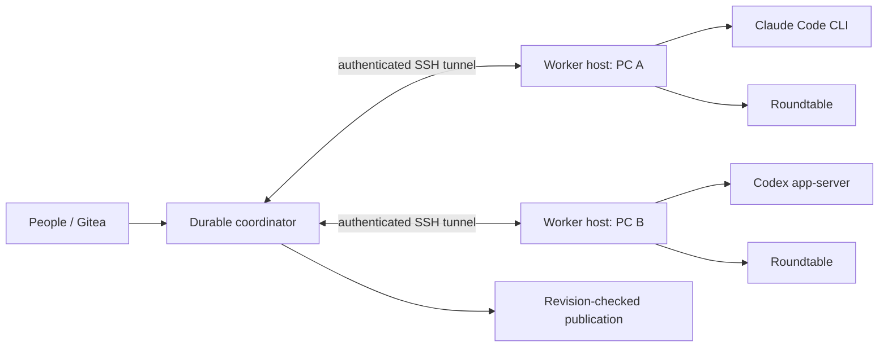

# Agent Collaboration Coordinator

[한국어](README.ko.md) · [API](API.md) · [Distributed protocol](DISTRIBUTED-CONTRACT.md) · [Verification](RESULTS-NATIVE.ko.md)

Keep Gitea as the shared task record while multiple people run their own Claude Code, Codex or Roundtable workers. Request revisions, execution ownership and publication receipts remain in a durable coordinator. Each computer has an independent worker host, so restarting the coordinator does not terminate its workers.

This repository is an executable implementation with isolated verification. It has not replaced an existing production issue agent or attached to anyone's open desktop conversation.

## Behavior

- Independent tasks run concurrently. One task has one current execution owner.
- Gitea comments and edits are checked against their canonical source. Explicit commands avoid pretending that a fixture understands natural language.
- A changed request is recorded before delivery. Native transport acceptance, queued input and worker acknowledgement are separate states.
- Stop targets a specific run. Resume creates a new run generation and can reuse an owned Claude/Codex native session.
- A restarted coordinator reconnects to the same authenticated worker ledger, run, native process and RT room. It does not infer termination from a disconnected network.
- Inputs written during downtime are backfilled from Gitea. Durable command receipts prevent duplicate actions.
- Outputs completed during coordinator downtime are collected as `result_ready`, `reviewed=false`. Receiving output does not automatically publish it or declare the task verified.
- Unknown external publication results are reconciled against the original comment before another effect is allowed.



## Verification boundaries

| Layer | Verified |
|---|---|
| Unit/protocol tests | SQLite races, process ownership, authentication, receipts, source replay and recovery on Windows/Linux |
| Native CLI | Actual Claude Code 2.1.306 and Codex 0.163.0, connected only to a local fake provider |
| Native + RT + recovery | 44 checks; actual coordinator SIGKILL/restart, direct CLI and real RT paths, completion while coordinator is down |
| Physical computers | 12 checks between Windows and macOS using deterministic workers and an SSH tunnel |
| Earlier Gitea integration | Real Gitea 28.1.0, real RT and deterministic CLI fixtures |

The native tests run with Docker `--network none`; the Gitea lab uses an internal Docker network. No real inference service is contacted. Zero model calls applies to the tests, not to future live work. Native reasoning quality, live account access and production deployment are separate concerns. The physical-PC test uses fake workers; it is not a claim that every native CLI/RT combination ran on both physical computers.

## Run tests

Python 3.12+; no Python package dependencies.

```sh
python -m lab.check
docker build -f Dockerfile.lab -t agent-collaboration-coordinator-lab:local .
docker run --rm --network none -v "$PWD/reports:/out" agent-collaboration-coordinator-lab:local -m lab.check --output /out/unit-linux.json
```

For native tests, provide licensed/installable Linux CLI binaries and an RT binary in an ignored local directory. Binaries and credentials are not included in Git.

```sh
docker run --rm --network none \
  -v "$PWD/.runtime/native-artifacts:/native:ro" \
  -v "$PWD/.runtime/native-check:/out" \
  agent-collaboration-coordinator-lab:local \
  -m lab.native_distributed --claude /native/claude-linux \
  --codex /native/codex-linux --rt /native/roundtable-linux --output /out
```

The physical-PC harness uses existing SSH authentication and verifies host keys. It creates and removes only a dedicated remote directory and its own worker/tunnel processes.

```sh
python -m lab.physical_pc_lab --ssh-config /path/to/ssh-config \
  --ssh-host test-host --remote-python /path/to/python3
```

The separate real Gitea lab is `lab/run_lab.py up --rt-binary /path/to/roundtable-linux`, then `test`, then `down`. It requires Docker and a local `gitea/gitea` image. Every run records its image IDs, binary hashes and observations under ignored `.runtime/`.

## Connect worker hosts

1. Start `python -m coordinator.worker_host --config <private worker config>` on each computer. Configure only the intended executable paths, engine types and owners.
2. Keep the worker listener on loopback. Connect the coordinator through a verified SSH tunnel. The remote client also supports HTTPS with certificate verification.
3. Start `python -m coordinator.server --config <private coordinator config>`. The `remote_workers` entries identify the node, engine, allowed owners and authentication secret.
4. Register selected Gitea issues. An old dispatcher must stop assigning those issues before any real cutover; this repository does not modify it.

Example configs and commands are in [API.md](API.md). Live native work is explicit: `mode=live`, `allow_model_calls=true`, a configured model, provider endpoint and `api_key_env`. The implemented native authentication path uses provider API credentials. Existing personal desktop/OAuth sessions are not imported. Fixture mode always uses isolated homes and dummy credentials.

## Recovery limits

Coordinator crash recovery is implemented and tested. A worker-host process crash or computer reboot is different: if the worker cannot prove ownership of its children, it reports `unknown` and does not create duplicate work. A changed worker ledger ID is rejected even when its hostname and token are unchanged.

The publication guarantee starts at an accepted request revision. It cannot account for unseen comments or actions that bypass the coordinator. General exactly-once external effects are not claimed. Arbitrary unstructured discussion still requires explicit source review. Git worktree creation, PR merges and deployment executors are outside the current publication adapter.

MIT licensed. Native CLI and RT binaries retain their own licenses.
